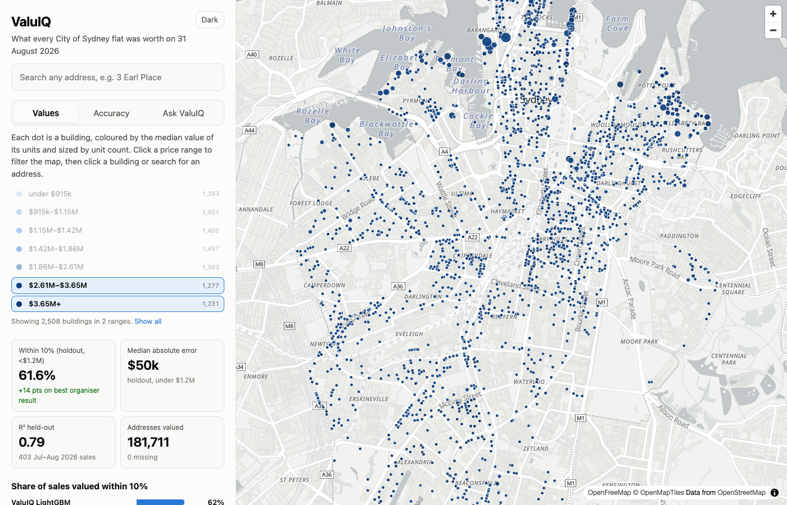
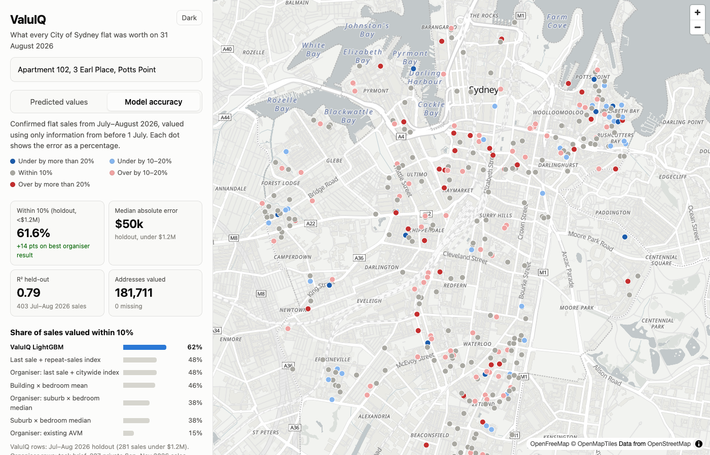

# ValuIQ

**Intelligent Property Valuation Through Data.**

ValuIQ values every flat in the City of Sydney, all **181,711** supplied addresses, as at **31 August 2026**. It explains each valuation with the evidence behind it, and wraps everything in an interactive map where anyone can look up a flat, explore prices across the city, and ask for recommendations in plain English.

Built for **Task 5: Value Every Flat** at the Microburbs Hackathon, 7 November 2026.

| | |
|---|---|
| **Submission file** | [`valuation_valuiq.csv`](valuation_valuiq.csv): 181,711 rows, `gnaf_id,value`, no missing values |
| **Report** | [`report.html`](report.html): data, method, validation, maps, limitations |
| **Held-out accuracy** | **61.6%** of July–August 2026 flat sales under $1.2M valued within 10%. Mean across three 2-month folds: **69.2%** |
| **Median absolute error** | **$49,714** (holdout, sales under $1.2M) |

---

## Who it helps

- **Buyers and sellers:** a fair, explainable price for any flat, including flats that haven't sold in years, with the comparable sales behind it.
- **Lenders and valuers:** a fast, consistent first estimate for every flat in the City of Sydney, with an honest error record.
- **Councils and planners:** a citywide picture of flat values by building, ready to map.

## The key idea: value the building, then the flat

Most flats haven't sold recently, but **their building usually has**. ValuIQ treats the building as the main unit of evidence:

1. **A repeat-sales price index.** We build a quarterly Bailey–Muth–Nourse index from tens of thousands of same-flat resales. It puts every sale since the 1990s on today's price footing.
2. **Point-in-time evidence.** For every flat, we bring past sales forward to today's prices:
   - in the same building, overall and for the same bedroom count
   - on the same street and nearby (distance-weighted)
   - in the same mesh block and suburb
   - the flat's own last sale
3. **A model that weighs the evidence.** LightGBM learns how much to trust each source of evidence for each flat, depending on how recent and plentiful it is and on the flat's attributes.

**Leakage control** is built in. Every feature, including those for the training rows, uses only sales dated *strictly before* that row's information date. The index, the training set and all features for the final valuation use only sales on or before 31 August 2026.

## Results

### Chronological validation

Each fold is a full rerun. The model, price index and every feature use only sales before the cutoff. It is then scored on **confirmed flat sales** from the supplied file in the next two months, valued using only the attributes in the supplied input file, exactly as at judging time. The headline fold mirrors the competition: information up to 30 June 2026, scored on July–August 2026 sales.

| Fold (information cutoff → scored sales) | Training sales | Validation sales (under $1.2M) | Within 10% |
|---|---|---|---|
| 1 Mar 2026 → Mar–Apr 2026 | 83,313 | 592 (389) | 74.6% |
| 1 May 2026 → May–Jun 2026 | 84,160 | 394 (256) | 71.5% |
| **1 Jul 2026 → Jul–Aug 2026 (headline)** | **84,814** | **403 (281)** | **61.6%** |

### Headline fold, sales under $1.2M

| Model | Within 10% | Median abs. error | MAE | RMSE | R² (<$1.2M) | R² (all sales) | Missing |
|---|---|---|---|---|---|---|---|
| Suburb × bedroom median (baseline) | 37.7% | $107,105 | $153,091 | $219,045 | −0.194 | 0.301 | 0 |
| Building × bedroom mean (baseline) | 45.9% | $92,737 | $120,398 | $180,456 | 0.190 | 0.444 | 0 |
| Last sale + repeat-sales index (baseline) | 48.0% | $88,635 | $127,056 | $274,961 | −0.882 | 0.406 | 0 |
| **ValuIQ LightGBM, 5-seed average (submitted)** | **61.6%** | **$49,714** | **$77,179** | **$116,149** | **0.664** | **0.788** | **0** |

For reference, the task brief reports the organiser's own results on the 227 private judging sales:
- existing Microburbs AVM: 34/227, or 15%
- suburb × bedroom median: 86/227, or 38%
- last sale plus citywide index: 109/227, or 48%

Our baselines reproduce those numbers closely (37.7% and 48.0%), which suggests our validation is set up fairly. These are indicative comparisons, because the sales sets differ.

### What worked, and what didn't

- **Worked:**
  - building × bedroom evidence, which is by far the most important feature
  - combining the supplied flat sales with API sales and repeat-sale pairs
  - OpenStreetMap location features, a small gain
- **Neutral:**
  - nearby-sales features: 69.2% with them vs 69.6% without, within noise. They're kept as evidence for buildings with no sales.
  - averaging five random seeds: about 1 point below the first seed alone, within noise. It's kept because it doesn't depend on a lucky seed.
- **Didn't work:**
  - CatBoost, which was unstable, and a CatBoost and LightGBM blend
  - a momentum adjustment for falling markets. Errors lean towards over-valuation as prices fell through 2026, but the trend before each cutoff didn't anticipate it.

## The ValuIQ web app

An interactive, map-centric app in [`app/`](app/), built with React and MapLibre GL on OpenFreeMap vector base maps.



- **Value map:** every building, coloured by the median value of its units and sized by unit count. **Click a price range in the legend to filter the map.**
- **Address lookup:** search any of the 181,711 addresses. The panel shows:
  - the ValuIQ value and a ±10% band
  - the evidence behind it: own last sale, same building, nearby sales
  - recent sales in the building, in today's dollars
  - every unit in the building
- **Value outlook, 1–5 years:** ValuIQ's own scenario, built from the repeat-sales index's 10-year trend, adjusted by suburb. Its range comes from a backtest that reran the same rule at every quarter since 2005. Backtest median error: 3.3% at 1 year, 7.7% at 3 years, 12.8% at 5 years. It's a scenario only, not part of the valuation.
- **Model accuracy map:** every holdout sale, coloured by valuation error, shown as a percentage only.
- **Ask ValuIQ:** a plain-English recommendation assistant. Ask, for example, *"I earn $100k a year and want a 2 bedroom under $600k in a safe suburb"*:
  - it reads the income or budget, bedrooms, parking, suburbs and lifestyle wishes (safe, quiet, family, vibrant, near a station, near the water)
  - it ranks real flats by ValuIQ value, suburb livability and street-level crime, and pins them on the map
  - it adds options just above budget when matches are scarce
  - it's rule-based and runs entirely in the browser



The lifestyle indicators (crime, livability, income, rent) are *current* Microburbs data. They're used only for recommendations and never as valuation features.

## How to run

Requirements: Python 3.11 or later, Node 18 or later, the supplied task files, and a Microburbs API key.

```bash
# 1. Set up
python3 -m venv .venv && source .venv/bin/activate
pip install -r requirements.txt
cp .env.example .env                          # then set MICROBURBS_API_KEY
unzip task5-valuation.zip -d data/task5       # supplied files (git-ignored)

# 2. Data
python -m src.preprocessing.fetch_api_data    # API unit sales up to 31 Aug 2026 (~15 min, cached)
python -m src.preprocessing.fetch_osm         # OpenStreetMap stations, parks, water, roads
python -m src.preprocessing.fetch_lifestyle   # suburb lifestyle data for the app's assistant

# 3. Validate, predict, report
python -m src.validation.run_validation       # 3 chronological folds -> outputs/
python -m src.predict                         # writes valuation_valuiq.csv and runs all submission checks
python -m src.report.build_report             # writes report.html

# 4. Web app
python -m src.demo.export_app_data            # writes app/public/data/ (git-ignored)
cd app && npm install && npm run dev          # http://localhost:5173
```

`src/predict.py` checks the output before finishing:
- exactly 181,711 rows, with the same ID set as the input and no duplicates
- no null, non-finite or non-positive values
- whole-dollar integers, exactly two columns, and a clean reload

## Repository structure

```text
src/
  api/microburbs_client.py         API client: retries, rate limiting, local cache, key never logged
  preprocessing/
    fetch_api_data.py              API addresses and sales (to_date = 2026-08-31)
    fetch_osm.py                   OpenStreetMap layers via Overpass
    fetch_lifestyle.py             suburb crime, livability, income, rent (app only)
    clean_data.py                  supplied files + API sales -> clean properties and sales
  features/
    feature_engineering.py         point-in-time building, nearby, mesh-block, suburb features
    location.py                    distances to stations, water, parks, major roads
  models/
    price_index.py                 quarterly repeat-sales (BMN) index
    outlook.py                     1-5 year outlook and its backtest
  validation/
    run_validation.py              chronological folds, baselines, LightGBM
    evaluate.py                    competition metrics and submission checks
  predict.py                       final model -> valuation_valuiq.csv
  report/                          report.html builder
  demo/export_app_data.py          data export for the web app
app/                               React + MapLibre web app
docs/                              screenshots
```

## Data sources and licences

| Source | Used for | Licence and terms |
|---|---|---|
| Microburbs supplied task files: input addresses, flat sales, repeat sales, mesh-block homes and people 2021–2026 | Address list, training sales, features | Hackathon use on the day only. **Not included in this repository.** The 2026 block figures are Microburbs estimates, not Census results. |
| Microburbs Hackathon API | Unit sales up to 31 Aug 2026 (valuation). Current suburb crime, livability, income and rent (app assistant only) | Hackathon terms. **No API output is included in this repository.** |
| Open G-NAF | Address identifiers | © Geoscape Australia, licensed by the Commonwealth of Australia under the Open G-NAF EULA (attribution and mailing restriction) |
| ABS 2021 mesh blocks and Census counts | Mesh-block features | © Commonwealth of Australia, CC BY 4.0 |
| OpenStreetMap via the Overpass API | Stations, parks, water, major roads | © OpenStreetMap contributors, ODbL |
| OpenFreeMap vector tiles | App and report base maps | © OpenStreetMap contributors, OpenMapTiles schema |

## Limitations

- **Bedroom data:** the supplied bedroom, bathroom and parking fields describe each address's last advert, and about 73% of addresses have no bedroom count. The model handles missing values explicitly.
- **API coverage:** four supplied suburbs outside the API's coverage (Annandale, Newtown, Paddington, St Peters) rely on the supplied sales only.
- **Sample size:** each validation fold has 256–389 sales under $1.2M, so differences of 2–3 points between models are within noise.
- **Falling market:** holdout errors lean towards over-valuation as prices fell through 2026. Further movement after 31 August 2026 couldn't be known at the valuation date.
- **Non-residential addresses:** shops, offices, suites and car spaces are valued with the same model. They aren't the focus of the flat judging set.
- **Scenario tools:** the 1–5 year outlook and the Ask ValuIQ assistant are scenario and exploration tools, not financial advice.

## Team

| Name | Contact |
|---|---|
| Alex Tanui | [@AlexTanui](https://github.com/AlexTanui) |
| Hanson Ernest | hansonernest7@gmail.com |
| Gitau Joseph | gitaujoseph64@gmail.com |

## Licence

Code is released under the [MIT Licence](LICENSE). Data remains under its own licences and terms, listed above.
